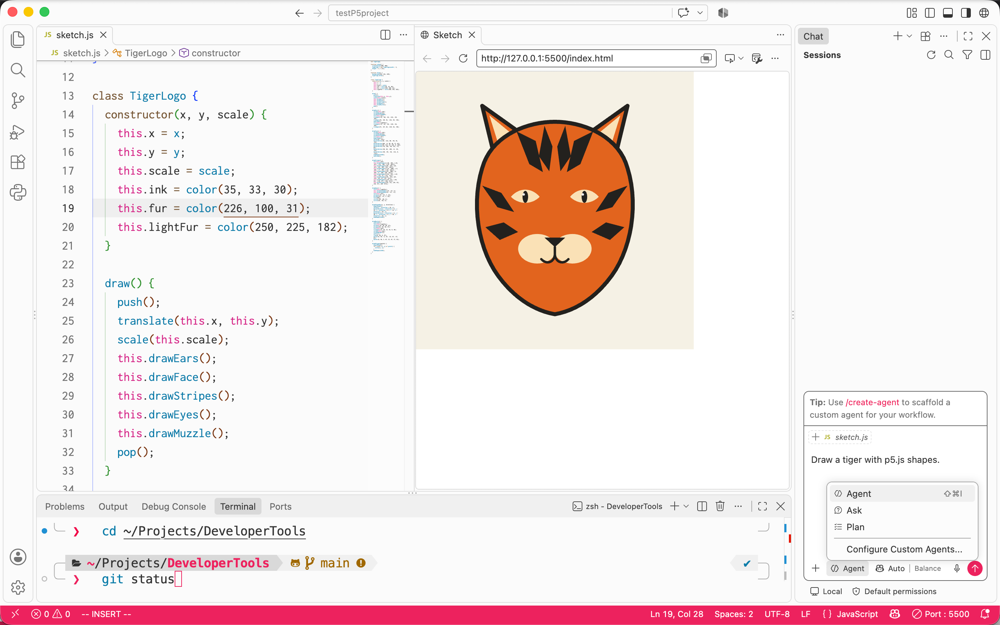

# Set Up Your Machine for Agentic Engineering

A *Bash script* is a sequence of commands in a file that the computer can run one by one, usually to move other files around. Bash is a programming language that uses the same fundamentals we've seen: variables, conditional statements, and for loops. 

This Bash script sets up your Mac for Tech Arts code & design projects. It installs tools for *agentic engineering* (building code by prompting a language model that can change files on your computer), as well as Sam Lavigne's p5.js VS Code extension, p5.vscode, which enables you to build and run p5.js sketches within VS Code. For a more unified and inviting learning experience, the script also matches the visual style of Visual Studio Code and your terminal prompt to the light color scheme of the [p5.js web editor](https://editor.p5js.org).

## What the setup does

The setup script installs these programs and settings for you:

- **Homebrew**, a tool that installs other programs from the command line.
- **Visual Studio Code**, the code editor we use in class, with the p5.js Editor Light theme; three extensions: p5.vscode and Live Server for p5.js sketches, and Error Lens for catching mistakes; and p5.js Live Sketch, a small helper from this repository that shows your sketch running beside your code.
- **oh-my-zsh** and **Powerlevel10k**, which give your terminal a colored, informative prompt.
- **zsh-autosuggestions** and **zsh-syntax-highlighting**, which suggest and color commands as you type.
- **MesloLGS NF**, a font with the symbols the prompt draws.
- **Inconsolata**, the same free and open font used in the p5.js editor.

The script does not delete anything. If your Mac already has one of the settings files it replaces, the script moves your old file into a folder named `DeveloperTools-backups` in your home folder.

## Your Copilot Chats Are Recorded

*For students and parents.* This setup records your chats with GitHub Copilot in Visual Studio Code and saves them in a school Google Drive folder. Please read this section before you run the setup.

**What is recorded:**

- Everything you type to Copilot in Visual Studio Code, and every reply Copilot gives.
- Anything Copilot reads or changes while it answers, such as the code in your project files.
- Your name, which the setup asks you to type once; the GitHub account you use to sign in to Copilot; and your Mac's user name and computer name.

Only chats with Copilot inside Visual Studio Code are recorded. Nothing else on your Mac is recorded, such as your web browsing, other apps, or AI tools you use in a web browser.

**Where it goes:** Your Mac saves each chat to a file in your home folder as you go, and you can read that file at any time in `~/Library/Logs/DeveloperTools-copilot/`. About every 15 minutes, the new part of that file is sent to a folder in the school's Google Drive, where each student has their own folder. Copilot itself also sends your chats to GitHub to answer them; that happens whether or not they are recorded.

**Who can read it:** Your Technical Arts teacher, the school's technology director, and the student deans. The folder is not shared with other students or with anyone outside the school.

**Why:**

- **To help you learn.** Your teacher uses Copilot to summarize what each student and the whole class understand well and still find hard, with quotes from the chats. (An AI summary can be wrong, so your teacher reads the actual chats before acting on one.)
- **Safety.** If a chat suggests that someone could be harmed, such as thoughts of suicide or self-harm, threats, hate speech, or requests to make weapons, the technology director and the student deans will follow up.

**Chats are not watched live.** It can take an hour or more before anyone sees a chat. If you or a friend need help now, talk to a dean, a counselor, or another adult you trust right away, or call or text **988**, the Suicide & Crisis Lifeline, at any hour.

**How long it is kept:** The school keeps the chats in Google Drive with no set end date.

If you or your parents have questions about the recording, ask your teacher before you run the setup.

## Before You Start

You need three things before you begin:

- **A Mac connected to the internet.** 
- **The password you use to log in to your Mac.** Your account must be an administrator account. If the script says you are not an administrator, you need to logout and log in as the admin user.
- **About 30 minutes.** Most of that time is waiting while things download.

## Terminal Basics

Terminal is an app where you control your Mac by typing commands instead of pointing and clicking. You will only need a few skills for this setup:

- **Running a command:** Copy a command from this page, click in the Terminal window, paste it with **Command-V**, and press **Return**. Terminal runs one command each time you press Return.
- **Waiting:** While a command runs, lots of text scrolls by. It will be a ton, and it's not important that you read or understand all of it. (But feel free to investigate!) Lines containing the word *warning*, such as `DeprecationWarning`, are not errors: the command is still working, and you can ignore them. If something actually goes wrong, the script stops and says so.
- **Typing your password:** When Terminal asks for your password, nothing appears on screen as you type, not even dots. This is normal. Type your password and press Return.
- **Stopping a command:** If something goes wrong and you need to stop a command, press **Control-C**.

## Set Up your Mac

Follow these steps in order.

1. **Open Terminal.** Press **Command-Space** to open Spotlight, type `Terminal`, and press **Return**. A window with a blinking cursor opens.

2. **Run the setup command.** Copy this whole line (cmd+C or press the two overlapping squares on the right edge of the code snippet), paste it into Terminal (cmd+V), and press **Return**:

   ```bash
   caffeinate -dis /bin/bash -c "$(curl -fsSL https://raw.githubusercontent.com/LWHSTechnicalArts/DeveloperTools/main/scripts/bootstrap.sh)"
   ```
This command downloads a script named `bootstrap.sh` from this repository and runs it. The word `caffeinate` at the start keeps your Mac awake until the script finishes, so it does not go to sleep partway through the half-hour setup: `-d` keeps the screen on, `-i` stops the Mac from sleeping when you are not using it, and `-s` stops it from sleeping while it is plugged in. Keep your Mac open and plugged in while the setup runs. The script installs Apple's Command Line Tools if your Mac does not have them, downloads this repository into a folder named `DeveloperTools` in your home folder, and then runs `setup.sh` to install and set up everything else.

3. **Type your password when asked.** Type your Mac login password and press **Return**. The script may ask more than once, because some steps take longer than macOS remembers your password.

4. **Accept the Xcode license, if asked.** Some Macs have Apple's Xcode app installed. If yours does and its license has not been accepted yet, the script stops and prints `Before the setup can continue, you need to accept Apple's Xcode license.` Then:

   1. Type your Mac password if asked, and press **Return**.
   2. When the license text appears, press the **space bar** until you reach the end.
   3. Type `agree` and press **Return**.

   The script then continues on its own. If your Mac does not ask, skip this step.

5. **Wait for the script to finish.** This takes about 30 minutes. The script prints a heading for each step, such as `==> Homebrew`. If a window opens asking to install the Command Line Tools, click **Install**, click **Agree**, wait for the installation to finish, and then press **Return** in Terminal. The script is finished when it prints `Done.` and shows the prompt again.

6. **Quit Terminal.** Press **Command-Q**. From now on, use the terminal built into Visual Studio Code, which has the matching colors and font. The tour below shows you how to open it.

Your Mac is set up.

## Check that Everything Works

This short tour checks that each part of the setup works and shows you the features it added. You start in Visual Studio Code, open the terminal inside it, and then try the terminal features there. Type each command yourself rather than pasting it, because several features react as you type.

### Check Visual Studio Code

1. **Open Visual Studio Code (VS Code).** Press **Command-Space**, type `Visual Studio Code`, and press **Return**. If macOS asks whether you are sure you want to open it, click **Open**. The editor uses the light p5.js Editor Light theme.

2. **Check the extensions.** Press **Command-Shift-X** to open the Extensions view. **p5.vscode**, **Live Server**, and **Error Lens** are in the list of installed extensions.

### Open the Terminal Inside Visual Studio Code

3. **Open the terminal.** Press **Control-\`** (the backtick key, above Tab), or choose **Terminal > New Terminal** from the menu bar. A terminal panel opens at the bottom of the window. It works like the Terminal app, but it is built into the editor so you can run commands next to your code. Click inside the panel to type in it. Press **Control-`** again whenever you want to hide or show it.

### Read Your Prompt

4. **Look at the prompt.** The prompt is the area where you type, and it has two lines. The first line shows the folder you are in, on a gray background. The second line starts with a pink `❯`, and the cursor after it is where your typing appears. The right side of the first line shows information about the last command you ran, which the next steps explain. If you see boxes or question marks instead of symbols, the MesloLGS NF font is missing; run the setup command again.

### Run Commands and Read the Results

5. **Check homebrew.** Run `brew --version`. It prints a line starting with `Homebrew` and a version number. A blue `✔` appears on the right side of the prompt: it means the last command succeeded.

6. **Make a mistake on purpose.** Type `ecko hello`, but do not press Return yet. The word `ecko` is pale green, because it is not a real command; the terminal colors commands as you type so you can catch typos before running them. Now press Return. The terminal says `"ecko" is not a command. Check the spelling, or press the Up arrow to fix it.`, and a pink `✘` appears on the right: it means the last command failed.

7. **Fix the mistake.** Type `echo hello`. This time `echo` turns blue, because it is a real command. Press Return, and the terminal prints `hello` with a blue `✔`.

### Let the Terminal Type for You

8. **Accept a suggestion with the right arrow.** Type just `ec`. Gray text appears after your cursor, completing the line to `echo hello`: the terminal suggests commands you have run before. Press the **Right Arrow** key to accept the suggestion, then press Return to run it. If you do not want a suggestion, keep typing and it disappears.

9. **Search your history with the up arrow.** Type `br` and press the **Up Arrow** key. The terminal fills in `brew --version`, the last command you ran that starts with `br`. Press the Up arrow again to go further back in time, or the Down arrow to move forward in time. Press Return to run it again, or press **Control-C** to cancel.

10. **Complete names with Tab.** Type `cd ~/Doc` and press **Tab**. The terminal completes the folder name to `cd ~/Documents/`, so you never have to type a long name in full. Press Return to move into your Documents folder; the prompt now shows `Documents`.

11. **Choose from a menu with Tab.** Type `cd ~/` and press **Tab** twice. A menu of the folders in your home folder appears. Use the arrow keys to highlight `DeveloperTools/`, press Return to choose it, and press Return again to move there. The prompt now shows `DeveloperTools` and, after it, `main` in blue: this folder is a git repository, `main` is its branch, and blue means nothing in it has changed.

### Move Between Folders

12. **Go home and come back.** Type `~` and press Return; you are in your home folder. Type `-` and press Return; you are back in `DeveloperTools`, because `-` returns to the folder you were just in.

13. **Check the folder names.** Run `ls`. Folder names appear in blue and end with a `/`, so you can tell them apart from files.

14. **Check the settings links.** Run `ls -l ~/.zshrc`. The line ends with an arrow pointing into your `DeveloperTools` folder, such as `-> /Users/yourname/DeveloperTools/zsh/.zshrc`. That arrow is the link the setup created: a file on your computer, `.zshrc`, is really pointer back to a file in the cloned repository.

### Create and Delete a File

15. **Create a file, then delete it.** Run `touch ~/practice.txt`. The `touch` command creates an empty file, here named `practice.txt` in your home folder. Run `ls ~` to see it in the list.

    Now run `rm ~/practice.txt` to delete it. Files deleted with `rm` skip the Trash and cannot be recovered, so the terminal asks first. It prints `(Type y and press Return to delete, or n and Return to keep.)` and then asks `remove /Users/yourname/practice.txt?`. You must answer with a `y` or an `n`:

    - Type `n` and press Return. The file is kept; run `ls ~` to check that it is still there.
    - Run `rm ~/practice.txt` again, type `y`, and press Return. The file is deleted; run `ls ~` to check that it is gone.

### Open Projects in the Editor from your Terminal

16. **Open a folder from the terminal.** While you are in `DeveloperTools`, run `code .` (the period means "this folder"). A new Visual Studio Code window opens with this folder's files in the sidebar. This is the quickest way to start working on any project: move to its folder in the terminal, then run `code .`.

### Make a p5.js Sketch with Copilot

This last part puts everything together: you create a p5.js project, watch it run right next to your code, and ask GitHub Copilot, the AI assistant built into Visual Studio Code, to draw a tiger.

17. **Create a p5.js project.** In Visual Studio Code, press **Command-Shift-P** to open the Command Palette, type `Create p5.js Project`, and press Return. A window opens asking for a folder. Go to your **Documents** folder, click **New Folder**, name it `tiger`, click **Create**, and then click **Open**. A new Visual Studio Code window opens with your project's files in the sidebar: `index.html`, `sketch.js`, `style.css`, and a `libraries` folder.

18. **Watch your sketch appear beside your code.** Within a few seconds, without any clicks, the new window arranges itself: `sketch.js` opens on the left, and your running sketch, a gray square, appears on the right in a browser built into Visual Studio Code. The setup installed a small helper, **p5.js Live Sketch**, that does this every time you open a folder with a `sketch.js` file in it. It starts **Live Server**, which serves your sketch at an address like `http://127.0.0.1:5500/index.html` and reloads it whenever a file is saved. While Live Server is running, the status bar at the bottom-right shows its port, such as **Port : 5500**.

    If the sketch does not appear, press **Command-Shift-P**, type `p5.js Live Sketch: Show Sketch Beside Code`, and press Return.

19. **Sign in to Copilot (first time only).** Copilot needs a GitHub account. In Visual Studio Code, hover over the Copilot icon in the status bar at the bottom of the window, choose **Use AI Features**, and follow the prompts to sign in with GitHub. If you do not have a Copilot plan, signing in gives you the free plan. Students can also [get Copilot for free through GitHub Education](https://docs.github.com/en/copilot/how-tos/copilot-on-github/set-up-copilot/enable-copilot/set-up-for-students).

20. **Ask Copilot for a tiger.** Click in `sketch.js` on the left. Press **Command-I** to open a chat box inside the editor, type `Draw a picture of a tiger using p5.js shapes`, and press Return. Copilot shows its suggested changes right in the file, with new lines highlighted. Read them over, then click **Keep** to accept them, or **Undo** to throw them away.

    There are two ways to chat with Copilot, and they open in different places:

    - **Command-I** opens a small chat box *over the code in the editor*, right where your cursor is. Use it for quick changes to the file you are looking at, like this tiger.
    - **Control-Command-I** opens the **Chat view**, a panel in a *sidebar* next to the editor. Use it for longer conversations: asking questions, getting explanations, or asking for changes across several files. The conversation stays in the panel while you work.

21. **Watch the sketch update.** About a second after you click **Keep**, Visual Studio Code saves `sketch.js` automatically, and Live Server reloads the sketch on the right, so the tiger appears without you touching it. (If it does not appear, press **Command-S** to save.) Copilot's drawing is different every time; try follow-up requests such as `Give the tiger bolder stripes`, and watch the sketch change after each one. You can also change the code yourself, such as a color number, and watch the sketch follow. If Copilot's code has a mistake, Error Lens shows the error message on the line, and you can ask Copilot to fix it.

22. **Open the sketch in your web browser (optional).** To see your sketch in Safari or Chrome too, click the address bar of the browser on the right, copy the address with **Command-C**, and paste it into your web browser's address bar with **Command-V**. That page also reloads whenever your code is saved, because the reloading comes from Live Server, not from the browser.

If a check fails, run the setup command from step 2 of the setup again, then repeat the tour. If it still fails, see [If something goes wrong](#if-something-goes-wrong).

### Quick Reference

| To do this | Press or type |
|---|---|
| Show or hide the terminal in Visual Studio Code | **Control-`** |
| Accept the gray suggestion | **Right Arrow** |
| Complete a command, file, or folder name | **Tab** |
| Show a menu of choices | **Tab** twice, then the arrow keys and **Return** |
| Find an earlier command | Type its first letters, then **Up Arrow** |
| Search all earlier commands | **Control-R**, then type part of the command |
| Stop a running command or cancel a line | **Control-C** |
| Clear the terminal | **Command-K** |
| Go to a folder | Type its name and press **Return** |
| Go back to the previous folder | `-` |
| Create an empty file | `touch` *name* |
| Delete a file (answer `y` to delete, `n` to keep) | `rm` *name* |
| Open the current folder in Visual Studio Code | `code .` |
| Start or stop Live Server | Click **Go Live** (or **Port : 5500**) in the status bar |
| Show the sketch beside your code | **Command-Shift-P**, then `p5.js Live Sketch: Show Sketch Beside Code` |
| Ask Copilot to change the code in a file | **Command-I** in the editor |
| Open the Copilot chat panel in the sidebar | **Control-Command-I** |
| Make the editor's text bigger or smaller | Hold **Command** and scroll |

## How Visual Studio Code Helps You Find Mistakes

Visual Studio Code is set up to point out common mistakes while you type.

- **Matching brackets:** when a pair of braces, brackets, or parentheses spans several lines, a thin colored line connects the opening one to its closing one, and the pair around your cursor is highlighted. If the lines do not match up the way you expect, a bracket is probably missing.
- **Error messages on the line:** the Error Lens extension prints each error or warning right at the end of the line that caused it, so you can read the message without hovering over a squiggly underline.
- **In the terminal:** if you type a command that does not exist, the terminal tells you so in plain words and reminds you that the Up arrow brings the command back so you can fix it.
- **Deleting files:** files you delete with the `rm` command skip the Trash and cannot be recovered, so the terminal reminds you of the answers and asks `remove ...?` before deleting each one. Type `y` and press Return to delete it, or `n` and Return to keep it.

### Reading Error Messages with Error Lens

Normally, Visual Studio Code marks a mistake with a squiggly underline, and you have to hover over it to read what is wrong. The Error Lens extension shows the message right away, at the end of the line that caused it.

- **Color tells you how serious it is.** The whole line is tinted, and the message is colored to match: red for an *error*, which stops your code from running; orange for a *warning*, which might cause a problem; and blue for *information*, which is a suggestion.
- **Messages update as you type.** When you fix the mistake, the message disappears.
- **Every problem is also listed in one place.** Press **Command-Shift-M** to open the Problems panel, which lists every error and warning in your open files. Click one to jump to its line.
- **You can copy a message to ask about it.** Click the line with the problem, press **Command-Shift-P**, and run **Error Lens: Copy Problem Message**. Then paste the message into Copilot's chat (**Control-Command-I**) and ask what it means.

Try it in your tiger project. In `sketch.js`, find the line that starts with `createCanvas(` and delete the `)` near its end. A red message, `')' expected.`, appears at the end of the line. Put the `)` back, and the message goes away.

Error Lens can only show mistakes that Visual Studio Code notices, which are mostly typing mistakes like a missing bracket. A misspelled p5.js function name, such as `creatCanvas`, may not be marked at all.

## How Visual Studio Code Saves Your Work

Visual Studio Code saves your files automatically, the way the p5.js web editor does, so you do not need to press **Command-S** after every change.

- **When it Saves:** about one second after you stop typing, Visual Studio Code saves the file you are editing.
- **With Live Server:** Live Server reloads your sketch in the browser every time a file is saved. Because saving is automatic, your sketch updates about a second after you stop typing. If you pause in the middle of a line, the sketch may briefly show an error; it fixes itself when you finish the line.
- **New Files:** a brand-new file has no name or folder yet. Save it once with **Command-S** and choose where it goes; after that, Visual Studio Code keeps saving it for you.
- **Undoing a change:** autosave writes over the file each time. To go back, press **Command-Z** to undo, one step at a time, while the file is still open.

## A Note on Running Commands from the Internet

The setup command runs a script straight from the internet, without showing it to you first. Homebrew's own installer works the same way. Only run commands like this when you trust where they come from: here, that is this repository, which your teacher maintains. You can read [bootstrap.sh](scripts/bootstrap.sh) before you run it; all the Bash scripts have been documented in detail, in case you want to learn more about the Bash scripting language.

## Keep the Folder Where it is

Keep the `DeveloperTools` folder in your home folder, and do not rename or delete it. Your settings files are *linked* to the files in this folder, the way a shortcut points to a file somewhere else. If the folder moves, the links break, and your terminal and editor lose their settings.

## If Something Goes Wrong

Running the setup command again is always safe. The scripts skip anything that is already installed, update your copy of this repository, and finish the rest. To run it again, open Terminal, paste the same command from step 2, and press **Return**.

Running the setup command again also brings in the newest class settings for Visual Studio Code. Any setting you changed yourself, in the Settings screen, is set aside first so the class settings can update; it is saved, not deleted. To use your own setting again, change it once more in the Settings screen (**Command-comma**).

These are the most common problems and their fixes:

- **`...DeveloperTools already exists but is not a copy of this repository`**: Your home folder already has a folder named `DeveloperTools` that did not come from this repository. Rename that folder in Finder, then run the setup command again.
- **`The Command Line Tools are still not installed`**: The Command Line Tools installation did not finish. Run the setup command again. If you see this message a second time, ask your teacher for help.
- **`Before the setup can continue, you need to accept Apple's Xcode license`**: Your Mac has Apple's Xcode app installed, and its license has not been accepted yet. Follow step 4 of the setup: press the space bar until you reach the end of the license, type `agree`, and press Return; the setup then continues on its own.
- **`bootstrap.sh stopped because the command on line ... failed`**: One step of the setup failed, often because the internet connection dropped. Read the lines above that message for the reason, then paste the setup command again.
- **`install.sh did not finish, so configure.sh was not run`**: One of the installs failed, often because the internet connection dropped. Read the lines above that message for the reason, then run the setup command again.
- **`Could not update; continuing with the copy already on this Mac`**: Your copy of this repository has changes made on your Mac, so the script kept your copy instead of updating it. Setup still finishes. Show the message to your teacher if you want the newest version.
- **The prompt shows boxes or question marks instead of symbols**: In Visual Studio Code's terminal, this means the MesloLGS NF font is missing; run the setup command again. The macOS Terminal app shows boxes because its font is not MesloLGS NF; use Visual Studio Code's terminal instead.
- **You need your old settings back**: Your previous files are in the `DeveloperTools-backups` folder in your home folder, in a subfolder named with the date and time the script ran. Ask your teacher before restoring one, because restoring removes the link to this repository.

If none of these fixes the problem, take a screenshot of the Terminal window and show it to your teacher.

## How the Scripts Work

The scripts are written to be read. If you are curious how a bash script works, open them in Visual Studio Code; every step has a comment explaining what it does.

The repository has three folders:

- `scripts/` holds the four setup scripts described below.
- `zsh/` holds the terminal settings: `.zshrc`, the shell's settings file, and `p5js-editor-light.p10k.zsh`, the prompt's colors and layout.
- `vscode/` holds Visual Studio Code's `settings.json`, the list of extensions to install in `extensions.txt`, the p5.js Editor Light theme in `p5js-editor-light/`, and the p5.js Live Sketch helper in `p5-live-sketch/`.

The scripts, all in the `scripts/` folder:

- `bootstrap.sh` is what the setup command runs. It installs Apple's Command Line Tools, downloads this repository, and runs `setup.sh`.
- `setup.sh` runs the other two scripts in order, and stops if the installs fail.
- `install.sh` installs the programs.
- `configure.sh` links your settings files to this repository and installs the Visual Studio Code extensions listed in `vscode/extensions.txt`.

---

## Reference links

### Agentic Engineering with GitHub Copilot

GitHub Copilot is built into Visual Studio Code. These guides explain how to work with it as an *agent*, an assistant that plans and makes changes across your project, directly in the files on your machine. Visual Studio Code allows for multiple agents to run [at the same time](https://code.visualstudio.com/blogs/2026/02/05/multi-agent-development).

- [Access GitHub Copilot for free as a student](https://docs.github.com/en/copilot/how-tos/copilot-on-github/set-up-copilot/enable-copilot/set-up-for-students): how students qualify for free Copilot access through GitHub Education.
- [Set up GitHub Copilot in Visual Studio Code](https://code.visualstudio.com/docs/setup/copilot): signing in to GitHub and turning Copilot on in Visual Studio Code.
- [Build with artificial intelligence in Visual Studio Code](https://code.visualstudio.com/docs/agents/overview): an overview of chat, agents, and the other artificial intelligence features in Visual Studio Code.
- [Understand artificial intelligence agents](https://code.visualstudio.com/docs/agents/concepts/agents): what an agent is and how it differs from chat and code completion.
- [Tutorial: Agentic coding in Visual Studio Code](https://code.visualstudio.com/docs/agents/agents-tutorial): a step-by-step first project built with an agent.
- [Best practices for using artificial intelligence in Visual Studio Code](https://code.visualstudio.com/docs/agents/best-practices): how to write requests, give context, and review what an agent produces.
- [Prompt examples](https://code.visualstudio.com/docs/agents/guides/prompt-examples): sample requests for common tasks.
- [Set up a context engineering flow in Visual Studio Code](https://code.visualstudio.com/docs/agents/guides/context-engineering-guide): planning work in steps and giving the agent the information each step needs.
- [Use custom instructions in Visual Studio Code](https://code.visualstudio.com/docs/agent-customization/custom-instructions): writing standing instructions that Copilot follows in every request, similar to this repository's `CLAUDE.md`.
- [Understand trust and safety for artificial intelligence agents](https://code.visualstudio.com/docs/agents/concepts/trust-and-safety): what an agent is allowed to do on your computer and how to keep it in check.
- [About GitHub Copilot agents](https://docs.github.com/en/copilot/concepts/agent-capabilities/about-agents/about-github-copilot-agents): the agents GitHub offers, including ones that work on GitHub itself.
- [Prompt engineering for GitHub Copilot Chat](https://docs.github.com/en/copilot/concepts/prompting/prompt-engineering): how to phrase requests to get better results.
- [Adding repository custom instructions for GitHub Copilot](https://docs.github.com/en/copilot/how-tos/copilot-on-github/customize-copilot/add-custom-instructions/add-repository-instructions): storing instructions in a repository so everyone's Copilot follows them.
- [GitHub Copilot documentation](https://docs.github.com/en/copilot): GitHub's full Copilot documentation.

### Documentation for everything the scripts install

- **Bash**, the language the setup scripts are written in: [Bash Reference Manual](https://www.gnu.org/software/bash/manual/)
- **Apple Command Line Tools**: [Installing the command-line tools](https://developer.apple.com/documentation/xcode/installing-the-command-line-tools)
- **git**: [Git documentation](https://git-scm.com/docs)
- **Homebrew**: [Homebrew Documentation](https://docs.brew.sh)
- **Visual Studio Code**: [Visual Studio Code documentation](https://code.visualstudio.com/docs), [the `code` command line](https://code.visualstudio.com/docs/configure/command-line), [color themes](https://code.visualstudio.com/docs/configure/themes), and [Homebrew's visual-studio-code package](https://formulae.brew.sh/cask/visual-studio-code)
- **p5.vscode** extension: [p5.vscode on the Visual Studio Marketplace](https://marketplace.visualstudio.com/items?itemName=samplavigne.p5-vscode)
- **Live Server** extension: [Live Server on the Visual Studio Marketplace](https://marketplace.visualstudio.com/items?itemName=ritwickdey.LiveServer)
- **Error Lens** extension: [Error Lens on the Visual Studio Marketplace](https://marketplace.visualstudio.com/items?itemName=usernamehw.errorlens)
- **p5.js**, the library the p5.vscode extension supports: [p5.js reference](https://p5js.org/reference/)
- **zsh**, the shell in Terminal and in Visual Studio Code's terminal: [Use zsh as the default shell on your Mac](https://support.apple.com/en-us/102360) and [zsh documentation](https://zsh.sourceforge.io/Doc/)
- **oh-my-zsh**: [oh-my-zsh wiki](https://github.com/ohmyzsh/ohmyzsh/wiki)
- **Powerlevel10k**: [Powerlevel10k](https://github.com/romkatv/powerlevel10k)
- **MesloLGS NF** font: [Powerlevel10k font guide](https://github.com/romkatv/powerlevel10k/blob/master/font.md)
- **Inconsolata** font: [Inconsolata on Google Fonts](https://fonts.google.com/specimen/Inconsolata)
- **zsh-autosuggestions**: [zsh-autosuggestions](https://github.com/zsh-users/zsh-autosuggestions)
- **zsh-syntax-highlighting**: [zsh-syntax-highlighting](https://github.com/zsh-users/zsh-syntax-highlighting)
